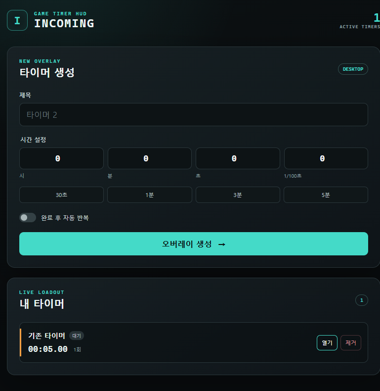

# Incoming 제품 식별자와 기존 설치 호환성

제품 표시명은 **Incoming**, 설명은 **Incoming Timer Overlay**다.
GitHub 조직 `incoming-timer`를 기준으로 영구 앱 식별자를
`io.github.incoming-timer.incoming`으로 사용한다. 운영 주체 후보나 법인명을
확정된 제작자 정보로 사용하지 않는다.

## 표시명과 내부 이름

- package.json의 productName과 electron-builder의 productName: Incoming
- 메인 창과 HTML 제목, 트레이 툴팁: Incoming
- 오버레이의 네이티브 창 제목: 사용자 타이머 제목 (UUID 제외)
- Windows 실행 파일: Incoming.exe
- 설치 파일: Incoming-Windows-<version>-Setup.exe
- 시작 메뉴와 바탕 화면 바로가기: Incoming
- Windows 제거 목록: Incoming <version>

package.json의 name은 호환성을 위해 `incoming-electron`을 유지한다.
npm 패키지 이름과 데이터 폴더 이름은 사용자에게 표시하는 제품명이 아니다.

## 기존 0.1.0 설치본 업그레이드

기존 appId `YourAppID`에서 electron-builder가 생성하던 NSIS 설치 GUID는
`e8a1d95b-2268-5534-a8b7-a46da8c43aa5`다. 새 appId를 적용하면서
`nsis.guid`를 이 값으로 고정해 기존 설치·제거 레지스트리 키를 유지한다.
이 GUID는 앞으로 변경하지 않는다.

NSIS는 기존 레지스트리의 설치 경로와 제거 프로그램을 사용해 이전 버전을
제거한 뒤 새 파일과 Incoming 바로가기를 설치한다. 기존 설치 경로에
YourAppName이 들어 있어도 경로를 강제로 바꾸지 않는다. 새 설치의 기본
디렉터리는 Incoming이다. 종료되지 않은 기존 앱은 먼저 정상 종료한다.

기존 app.asar의 package.json에는 productName이 없어 Electron의 userData
기본값은 appData 아래의 `incoming-electron`이었다. 새 표시명에 따라 빈
Incoming 데이터 폴더로 바뀌지 않도록, ready 이전에 같은 userData 경로를
명시적으로 설정한다. Windows에서는 일반적으로
`%APPDATA%/incoming-electron`이며 data.json과 timer-settings를 그대로 사용한다.
데이터를 복사·덮어쓰기·삭제하지 않는다.

명시적 `--user-data-dir` 옵션이 있으면 해당 경로를 존중한다.
Playwright 테스트는 테스트별 격리 프로필을 사용한다.
`deleteAppDataOnUninstall: false`도 유지한다.

## Windows 설치 스모크 체크

기존 설치가 없는 별도 Windows 테스트 환경에서 수행한다.

1. 기존 0.1.0 YourAppName 설치 파일을 설치한다.
2. 타이머를 생성하고 앱을 정상 종료한다. data.json과 overlay-settings.json을
   백업해 비교 기준을 확보한다.
3. 새 Incoming 설치 파일을 실행한다. 기존 설치 경로가 재사용되는지 확인한다.
4. 제거 목록에 Incoming 항목 하나만 있고 YourAppName 항목이 없는지 확인한다.
5. 바로가기 이름과 대상이 Incoming / Incoming.exe인지 확인한다.
6. 앱을 실행해 메인 창·트레이 이름, 기존 타이머와 설정, 오버레이 제목을 확인한다.
7. 재실행 후에도 데이터가 유지되는지 확인한다.
8. 제거 후 앱과 바로가기는 정리되고 사용자 데이터는 유지되는지 확인한다.

자동 검증은 단위 테스트에서 기존 경로와 명시적 프로필 정책을,
Electron E2E에서 실제 패키징된 실행 파일의 표시명·데이터/설정 읽기와
재실행을 확인한다. 설치·업그레이드·제거의 OS 변경은 위 절차로 별도 확인한다.
Electron/E2E 실행은 AGENTS.md에 따라 GUI 가능한 escalated 환경에서 수행한다.

## TEA-44 검증 결과 (2026-10-10, Windows x64)

- 타입 검사·lint 및 단위 테스트 40개 통과
- 실제 패키징된 Incoming.exe 복구·재실행을 포함한 Electron E2E 4개 통과
- 기존 YourAppName 0.1.0 설치 → 데이터 생성 → Incoming 설치로 업그레이드 →
  재실행 → 제거 스모크 테스트 통과
- 기존 설치 경로와 GUID 기반 등록 항목 재사용, Incoming 0.1.0 제거 목록,
  시작 메뉴·바탕 화면 바로가기의 Incoming.exe 대상 확인
- 기존 실행 파일과 YourAppName 바로가기 제거, 타이머와 설정 유지 확인
- 테스트 설치·바로가기·새로 생성한 설치 캐시 정리 확인

설치 스모크는 기존 설치·바로가기·캐시가 없는 상태에서 임시 설치 경로와
명시적 --user-data-dir 격리 프로필로 수행했다. 실제 사용자 프로필은 변경하지
않았으며, 기본 incoming-electron 데이터 경로 유지 정책은 단위 테스트로
별도 검증했다. 앱 표시명과 네이티브 창 제목은 Electron에서 읽어 확인했다.

패키징된 앱 화면 (창 제목 Incoming은 E2E로 별도 검증):

